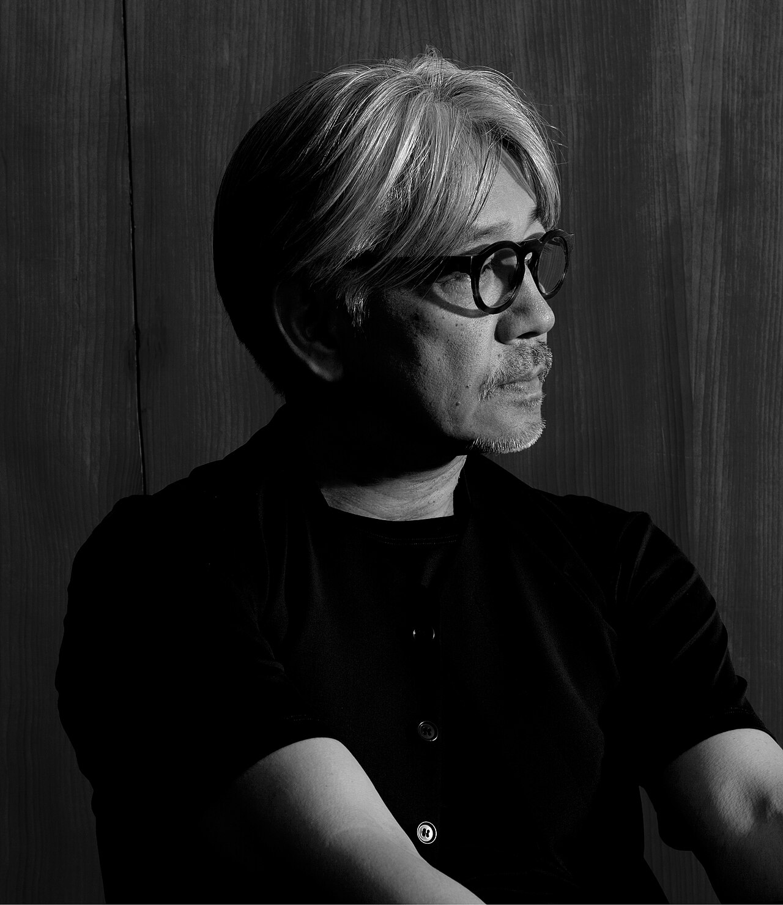
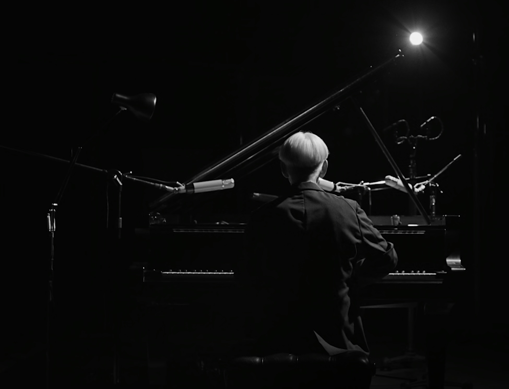
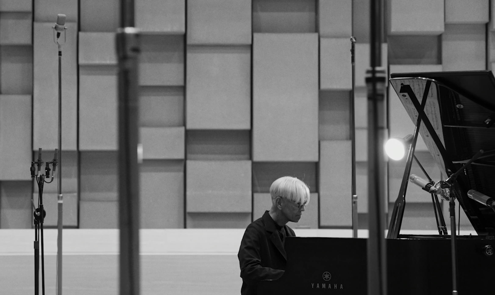

---
{
    "timezone": "CET",
    "location": "Lausanne"
}
---
# On Sakamoto's Opus

[comment]: <TODO: add link to tribute mixtape>

@marginnote: 

For the past few weeks, I've been going down the Ryuichi Sakamoto rabbit hole. I have gone through his albums, one by one, reading Wikipedia page after Wikipedia page trying to understand the full picture of this man. It started with me discovering "[Diabaram](https://youtu.be/19qDm_3ATJo)" a year ago now. There is just nothing like it. Which led me to Derrick's [introduction](https://youtu.be/r4Osxyp0fTY) where he puts him up there with a lot of greats. I thought, "I should check him out" and with every song I digested I got hungry for more. Which is why we are now here.

As a small summary, [Ryuichi Sakamoto](https://www.nts.live/shows/soup-to-nuts-anu/episodes/soup-to-nuts-w-anu-18th-january-2023) was a Japanese musician, composer, keyboardist, singer, and actor. He studied at the Tokyo National University of Fine Arts and Music, where he co-founded the synth-based band Yellow Magic Orchestra (YMO) with [Haruomi Hosono](https://www.nts.live/shows/soup-to-nuts-anu/episodes/soup-to-nuts-anu-22nd-september-2026) and [Yukihiro Takahashi](https://www.nts.live/shows/soup-to-nuts-anu/episodes/soup-to-nuts-anu-15th-february-2023). Together, they pioneered a number of electronic music genres. He then went on as a solo artist. During the next 45 years, he released over 20 solo studio albums, 10+ live albums, several compilation albums, over 40 EPs and singles, and about 48 soundtracks. He has dabbled in  classical, electronic, ambient, avant-garde, electro, electro-pop, experimental, film score, glitch, minimal, synth-pop, techno, and "world" music 
@sidenote: which he coined as neo-geo music
.

On top of being a creator of great renown, he also was a great curator with an excellent overview of the current musical world. You can read the whole [story](https://www.nytimes.com/2018/07/23/dining/restaurant-music-playlists-ryuichi-sakamoto.html) yourself, but he once hated the music in his favourite restaurant so much that he forced the owner to let him curate the playlist himself. In that playlist, you'll find so many unexpected finds from a man who was in his late 60s at that point. 

---

After going through most of his albums, I finally was able to get ahold of his documentary "Coda". The documentary was started following his activism against nuclear in Japan but turned into a broader look at his life, his diagnosis with cancer, his passion for music, and the creation of his album *Async*. Through that documentary, you not only see his passion for sound, where it comes from, and how much joy he gets from recording one that fits with his creative vision, but he also explains his thoughts on nature. We all are only spending but a brief time on Earth, and using that time to take in our environment is just as important to being active. 

The documentary was a lovely experience to get to meet the man I had until then only heard through music. Getting to see why he used the sounds that he did, and the creative decisions he took to make *Async* gave the whole project even more importance to me.

---

<iframe width="672" height="378" src="https://www.youtube-nocookie.com/embed/AXDscN2jBK4?si=c97gGSWssDArTuQu" title="YouTube video player" allow="accelerometer; autoplay; clipboard-write; encrypted-media; gyroscope; picture-in-picture; web-share" referrerpolicy="strict-origin-when-cross-origin" allowfullscreen></iframe>

Now we get to why I had to write this article. His final work: *Opus*. Six months before his death, he and his team worked together to put on a final performance. An hour and a half of him playing some of his life's work alone on the piano. Watching it, you inevitably start noticing a lot of details. He looks thin, small, and tired. You can hear his breathing coming through on the microphones. He had been struggling with his health for a long time, and the whole project had to be filmed over a few days because of it. 

However, despite his health, the music does not suffer. As if to honour the songs themselves, you can tell he gives it his all to play them as best he can. I don't know if it’s pride, stubbornness, or passion, but while playing, he rarely loses composure. If you only listened, you almost wouldn't be able to tell how exhausted he must have been. Were it not for the moments in between the songs where he tells the crew he needs a break. Added to the fact that he plays his compositions slower than normal, either intentionally or because of his health, which underlines the finality of the movie.

Some of the highlights I wanted to mention:

**Lack of Love**

@marginnote: 

The concert starts with him playing the [opening theme](https://youtu.be/bLVKA6cTTXU?si=8Vk4VM5xN1eWXA3C) of L.O.L: Lack of Love, a video game released in 2000 for which he made the soundtrack. The game revolves around the player's control of a single creature placed on an alien planet during robotic terraforming. The player must cause the creature to metamorphose into new forms by communicating with other living creatures, establishing symbiotic relationships with them, and thus helping them. It is fitting with the fact that Sakamoto spent a lot of his life being an activist against climate change and speaking out about our deteriorating relationship with nature.

This solo piano reinterpretation starts us off timidly, slowly, and mechanically. Sakamoto feels frail. The piece slowly opens up to being warmer, almost melancholic but still foreboding. Even without knowing the context, we know that we are at the end. 

The camera slowly creeps up from filming his back to looking over his shoulder. It feels equally intimidating and violating. Like we are watching him play in his living room but aren't supposed to be there. It is only in the following track that we are allowed to see his face.

**Andata** 

I have a bunch of thoughts on Andata. The piece comes from his nineteenth solo studio album *Async* and was the first full-length solo record after his recovery from throat cancer. Despite recovering from the disease in August 2015, Sakamoto thought *Async* would be his last album: "That’s why I tried to forget all the rules and forms, anything. I just wanted to put down just what I wanted to hear, just a sound or music, it doesn’t matter. This could be the last time."
@sidenote: "[Ryuichi Sakamoto interview](https://web.archive.org/web/20191115140906/https://andybeta.com/2017/06/12/ryuichi-sakamoto-interview/)". Andy Beta Official Website

The original Andata is textured, electronic, hazy, and grows throughout the entire piece. It also has a distinct organ part, which I didn't think could be removed. The solo piano version from *Opus* has less grandeur, but it retains all the weight of the piece. With all the microphones, we also keep all the texture. The entire piece is sustained and sinks deeper and deeper. Andata was the only track made before Sakamoto's cancer diagnosis that appears on async. It is interesting to me that he kept it on the album when the rest lives in a different space to me. 

The piece ends with him breaking up the phrasing with pauses. In contrast with the rest, it made me almost scared. We went down the steps to the basement and hit rock bottom. Now, where do we go? 

**for Jóhann**

Before the piece even starts, we see Sakamoto coughing, his head leaned into his hand, his glasses removed from his nose, and lying on the piano. The sound is cut off during this sequence. It then suddenly cuts to him before he starts playing, with his back almost too straight.

From a Twitter post by him: "This piece was written by Sakamoto in memory of his friend, Jóhann, who passed away suddenly in 2018. As the left hand steadily plays chords in the high keys, alluding to the melody, the right hand moves continuously as if it is conducting. It is as if he is sending signals to his departed friend."

Sakamoto being himself terminally ill. I wonder if he was thinking of what kind of elegies people would make of him after he joined his friend. 

**Bibo no Aozora** 

Meaning "Alluring Azure Sky", Bibo no Aozora was first released on his album *Smoochy* in 1995 as a trip-hop track with Sakamoto on vocals. It was then rearranged for a piano trio in his album *1996* and appeared at the end of Alejandro González Iñárritu's *Babel*.

The piece evokes to me almost a back and forth between a descent into deterioration and moments of hope. The theme has the melody repeating the same phrase, each going lower and lower. In *Opus*, he plays it slower, making it feel like his last walk down the steps. Between the descents, the melody opens up into higher keys. Feeling as if we were floating above water, taking a breath of fresh air. 

Near the end, during the improvised part of the piece, Sakamoto stops and tries again multiple times, not being satisfied with the way he plays. He struggles and finishes the piece by telling the crew he wants to record the entire thing again.

**Merry Christmas, Mr Lawrence**

The last piece of the movie is his infamous "Merry Christmas, Mr Lawrence". Ryuichi Sakamoto composed "Merry Christmas, Mr. Lawrence" in 1983 as the main theme for Nagisa Ōshima's World War II film of the same name. He has played this piece probably a thousand times since its first appearance in the movie. Browsing the internet, you can find dozens of versions and reinterpretations. Despite me listening to it an uncountable amount of time, hearing him play the first notes brought tears to my eyes. The piece grows in volume, with it reaching a peak so epic, it is a fitting end for a man who has lived a life of music. 

---

@marginnote: 

This concludes my journey of going through this man's life. I hope my feelings of respect, admiration, and passion for this man's work were able to reach any of you reading. Going through his interviews, documentaries, albums, and collaborations, you see a man who's lived deeply. He never shied away from exploring new sounds, finding new horizons, and has kept his curiosity for music up until the day he died. Be it in his own work or in his taste for everything else. 

In *Coda*, Sakamoto shows his care for the future. He uses his voice to support activism and talks about man’s relationship with nature. You see him struggle with his treatment but refuses to let it kill his spirit. He composes the soundtrack to the award-winning movie "The Revenant" despite being on hiatus, goes out of his way to find a tsunami-damaged piano, tours the restricted containment zone near the Fukushima nuclear plant, journeys to the Arctic to gather raw and ambient sounds, all while recovering from throat cancer.

At the end of *Opus*, the camera stays fixed on the piano he was playing. We see the keys move, and the music play, without Sakamoto being there to press them. Even with him gone, his legacy remains. 

> I honestly don't know how many years I have left. It could be twenty years, ten years, or a relapse reduces it to just one. I'm not taking anything for granted. But I know that I want to make more music. Music that I won't be ashamed to leave behind - meaningful work.
*— Ryuichi Sakamoto, Coda*

Ars longa, vita brevis

[comment]: <TODO: add review on biography>
